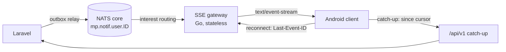

# One push path for de-Googled notifications: NATS + SSE

A concrete proposal for the Meningspunktet developers, from the maintainer of the
unofficial Android client.

The app works today by polling (60 s in the foreground, 5 minutes in the
background). This is the single change that would make notifications instant,
cheap on battery, and cheaper for the site than per-minute polling from every
device: a small **server-sent events** gateway on Meningspunktet's own servers,
fed by **NATS**. No FCM, APNs, Mozilla push or third-party distributor in the
path.

## The shape



Three parts:

- Laravel publishes one small event when a notification or message is created.
- NATS delivers it **only** to the gateway node holding that user's open
  connection, because the node subscribed to `mp.notif.user.<id>`. No shard map,
  no broadcast-and-filter.
- The gateway writes one SSE frame. The client never learns NATS exists.

The API stays the source of truth; the stream is only a wake-up. That is what
makes disconnects harmless: on every (re)connect the client asks for everything
since its cursor.

**Scale-out is linear and needs no redesign at any point up to 5M installs.**
Every tier grows by adding nodes; nothing is resharded, re-partitioned or moved:

- **Gateway**: stateless; new nodes go behind the load balancer and are done.
- **NATS**: a fixed 3-node cluster; interest routing picks up new gateway nodes
  with zero configuration.
- **API (Laravel)**: stateless behind the same load balancer. It serves the
  catch-up requests and the polling fallback, and carries real notification
  traffic — see "Notification traffic PHP still sees" under Scale.
- **Redis**: one primary plus a replica at every tier listed here; counters,
  presence, the auth cache and the per-user hot feed.
- **MySQL**: reads scale with read replicas and a Redis hot set; writes
  (creating notifications and messages) are the site's existing workload and are
  not increased by this design.

## What to build

### 1. Catch-up API (the contract that matters)

```http
GET /api/v1/notifications?since=<cursor>&limit=50
Accept: application/json
```

```json
{
  "data": [
    {
      "id": "01J...",
      "type": "reply",
      "title": "Svar fra Mette",
      "body": "…",
      "url": "/forum/…",
      "created_at": "2026-11-21T08:00:00Z",
      "unread": true
    }
  ],
  "meta": { "next_cursor": "01J..." },
  "unread": { "notifications": 3, "conversations": 1 }
}
```

```http
GET /api/v1/conversations?since=<cursor>
```

```json
{
  "data": [
    {
      "uuid": "…",
      "type": "group",
      "title": "…",
      "group": { "title": "…" },
      "avatar_file_id": "…",
      "last_message": {
        "id": 1234,
        "body": "…",
        "author": { "id": 9, "name": "…" },
        "created_at": "2026-11-21T07:59:00Z"
      },
      "unread": {
        "messages": 2,
        "threads": 1,
        "last_read_at": "2026-11-21T07:40:00Z",
        "newest_unread": { "id": 1234, "body": "…", "author_id": 9 }
      }
    }
  ],
  "meta": { "next_cursor": "…" }
}
```

Why this and not the current Inertia pages:

- versioned prefix and a documented response contract;
- no `X-Inertia`, no scraped asset hash, no 409 round-trip;
- explicit unread fields instead of guessing between `lastMessage.isUnread`,
  `hasUnreadReplies` and `hasUnreadMessages` — which is what forced the client to
  fetch `load-messages` pages just to quote the right message;
- a stable cursor, so a reconnect is one request instead of page diffs.

### 2. The SSE endpoint

```http
GET /api/v1/stream
Accept: text/event-stream
```

```
retry: 30000

event: unread
data: {"notifications":3,"conversations":1}

id: 01J...
event: notification
data: {"id":"01J...","title":"Svar fra Mette","url":"/forum/..."}

: heartbeat
```

- auth: the existing session cookie, or the per-device token in §4;
- on connect immediately emit the current `unread` snapshot;
- `id:` carries the event id so `Last-Event-ID` resumes;
- heartbeat comment every ~30 s so proxies keep the connection;
- `retry:` gives clients a reconnect hint; they still apply jitter.

Plain `text/event-stream` over HTTPS/2: no second protocol on the client, no
custom framing, works through ordinary proxies.

### 3. NATS

- **Core NATS, not JetStream.** The API is the record; at-most-once wake-ups are
  enough, so skip persistence, consumers and Raft quorum.
- Subject `mp.notif.user.<user_id>`, one subscription per open connection. NATS
  routes a message only to nodes with interest, so gateway nodes need no sharding
  and no cluster-wide broadcast.
- Publishing: `basis-company/nats` from Laravel, or — preferable — write an
  `outbox` row in the same transaction as the notification and let a ~50-line
  relay publish it. A request handler publishing inside a transaction loses
  events on rollback otherwise.
- Three-node cluster for availability; one static binary, no ZooKeeper/KRaft.
- Permissions: Laravel may publish `mp.notif.>`; the gateway may only subscribe.

### 4. Per-device tokens (recommended, not required)

```http
POST /api/v1/tokens          # session-authenticated, from a settings page
→ { "token": "mp_…", "scopes": ["notifications:read"], "id": "…" }
```

- shown once, stored hashed, listed and revocable per device (Sanctum shape);
- replaces cookie/CSRF scraping for native clients;
- a lost phone is revoked without changing the password.

### 5. Redis for counters and presence

- `unread:{user_id}` updated when events are created; the gateway and the catch-up
  API both read it, and the API can derive an ETag from it so most requests cost
  no database query;
- presence: `user:<id> → gateway node` (or a NATS KV record) to answer "is this
  user connected" without guessing.

## What the client does

- keeps the foreground service and opens `/api/v1/stream`;
- on connect or reconnect: catch-up since the stored cursor, then stream;
- an event → notification immediately (subject to the "never notify about your
  own message" rules already in the app);
- stream unavailable → adaptive polling fallback that already exists (60 s
  foreground, 5 min background) with jittered backoff;
- Android Doze will drop sockets; reconnect is the normal path, not an error.

## Scale

Event volume is not the problem: a forum of this size produces tens of events per
second at most, so NATS and PHP are never the bottleneck. Connection count is:

| Installs | SSE connections | Gateway fleet | TLS churn (15–30 min lifetime) |
|---|---|---|---|
| 100k | 100k | 2–3 nodes (~2 GB) | 55–110 handshakes/s |
| 1M | 1M | ~10 nodes (~20 GB) | 550–1,100 handshakes/s |
| 5M | 5M | ~25–50 nodes (~100 GB) | 3,000–6,000 handshakes/s |

For comparison, fixed 60 s polling at 5M devices is ~83k req/s for the
notification feed alone (~167k with conversations), which is on the order of a
thousand cores on classic PHP-FPM — the number this proposal removes.

**Notification traffic PHP still sees.** The stream removes the per-minute wake-up,
not the reads: every connect/reconnect is one catch-up request, and devices with
no held socket poll on the adaptive fallback. Peak is bounded by concurrent
connects, and steady state by how many devices fall back:

| Source | 100k installs | 1M installs | 5M installs |
|---|---|---|---|
| Reconnects → catch-up (15–30 min socket lifetime) | 55–110 req/s | 550–1,100 req/s | 3,000–6,000 req/s |
| Fallback polling (10 % of devices offline, 5 min interval) | ~33 req/s | ~333 req/s | ~1,700 req/s |
| Total API load | <200 req/s | <1,500 req/s | <8,000 req/s |

For context: the same traffic at a fixed 60 s poll would be 1,700 / 16,700 /
83,000 req/s. The 304-only path (counter unchanged in Redis) costs no database
query, and Laravel behind the load balancer scales horizontally like any
stateless tier; at 5M installs this is a double-digit node count at ordinary
request sizes, sized the same way the website itself is sized.

The cost that remains is operational: connection churn dominates CPU, deploys must
drain connections gracefully, and the fleet must be monitored. That is the bill
FCM currently absorbs.

## Hardware

Assumes TLS 1.3 on the gateway, ~25 KB per socket, 30 s heartbeat, 15–30 min
connection lifetime, 1–2 ms per handshake.

| Component | 100k installs | 1M installs | 5M installs |
|---|---|---|---|
| SSE gateway | 2–3 × (2 vCPU, 4 GB) | 8–12 × (4 vCPU, 8 GB) | 25–40 × (8 vCPU, 16 GB) |
| NATS (core, 3 nodes) | 3 × (1 vCPU, 2 GB) | 3 × (2 vCPU, 4 GB) | 3 × (4 vCPU, 8 GB) |
| Redis + replica | 2 × (1 vCPU, 2 GB) | 2 × (2 vCPU, 4 GB) | 2 × (4 vCPU, 8 GB) |
| Load balancer | managed / pass-through | managed | managed or 2 × HAProxy |
| API (Laravel + PHP-FPM) | 2 × (4 vCPU, 8 GB) | 6–10 × (4 vCPU, 8 GB) | 15–25 × (8 vCPU, 16 GB) |
| MySQL | existing + 1 read replica | 1 primary + 2–3 replicas | primary + read replicas, hot set in Redis |
| Outbox relay | 1 × (1 vCPU, 1 GB) | 1 × (2 vCPU, 2 GB) | 2 × (2 vCPU, 4 GB) |

- The gateway is memory- and connection-bound: 100k sockets ≈ 2.5 GB, 5M ≈ 125 GB,
  roughly 200k sockets per 16 GB node. CPU is dominated by handshakes (3–6k/s at
  5M ≈ 5–10 cores fleet-wide), not by messages.
- API nodes serve catch-up + fallback + the existing website: ~1,000 req/s per
  4 vCPU node at ordinary Laravel request costs, so the 5M column is a
  double-digit node count; 304 responses (counter unchanged in Redis) bypass the
  database entirely.
- Hit kernel limits before hardware: `nofile`, `somaxconn`, SYN backlog, port
  range, conntrack; long idle timeout on the LB; terminate TLS on the gateway.
- Do not size for the thundering herd: 5M reconnects inside 30 s is ~167k
  handshakes/s (≈ 250 cores). Jitter, `retry:`, staged drain.
- NATS memory follows subscription count (~5M subs ≈ 1–3 GB), not message rate;
  core NATS keeps nothing on disk.
- Network: ~7 MB/s of heartbeats at 5M, plus a few hundred Mbit/s during
  handshake peaks.
- Cost order of magnitude: €2k–5k/month at 5M on commodity VPS, 2–3 small VMs at
  100k.

## Why not the alternatives

| Option | Verdict |
|---|---|
| Fixed polling | request rate scales with installs; the problem being solved |
| Long-polling | still one request per hold (200k req/s at 5M with a 25 s hold); worse than polling |
| Kafka | does not hold connections, adds a cluster (KRaft, partitions, monitoring); only justified as a general event platform |
| MQTT broker | works, but adds a second protocol and a persistent-session backlog you do not want once the API is authoritative |
| UnifiedPush / ntfy | good fallback if you never want to run a gateway; delivery and metadata move to the user's distributor |
| Web Push | always relays through the browser vendor's push service; not de-Googled |

## Rollout

- Add the read-only API and `/api/v1/stream` behind a flag; the Inertia pages,
  cookies and CSRF behaviour stay exactly as they are.
- Ship the gateway and NATS as new services; nothing needs to move out of the
  Laravel application except the publish call.
- Clients keep polling until the stream answers, then switch; no flag day.
- If the gateway is down, every client degrades to polling automatically.

Questions or a draft controller/gateway skeleton: open an issue in this repository
(https://github.com/lasseborly/unofficial-meningspunktet-android/issues) and it
can be forwarded, or contact the app maintainer (see `SECURITY.md`).
