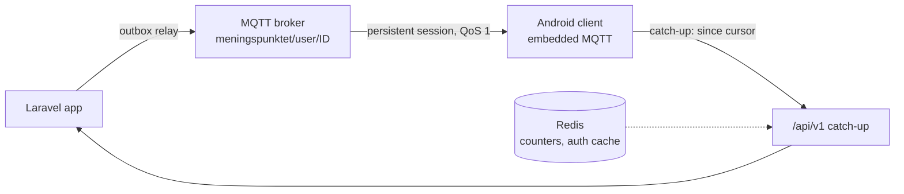

# Push notifications without Google: MQTT (executable plan)

A concrete proposal for the Meningspunktet developers, from the maintainer of the
unofficial Android client. One architecture, stated plainly, with a build order.

## Requirements

| # | Requirement |
|---|---|
| R1 | A new notification reaches the user's screen within **10–15 s**, even with the app in the background |
| R2 | No third-party push servers: no FCM, APNs, Mozilla, no push distributor |
| R3 | Additive: the Inertia pages, session cookies, CSRF and website behaviour stay exactly as they are |
| R4 | Scales to **5M installs by adding nodes** — no redesign, no resharding, no flag day |
| R5 | The app keeps working by polling until the server side ships |
| R6 | Minimum infrastructure cost and code |

R1 decides the architecture: a background phone has no inbound address, so some
always-on server must hold a connection to every running device. This design puts
that connection tier in an off-the-shelf **MQTT broker**, not in hand-written PHP
or Go.

## Architecture



| Component | Language | Role | Grows by |
|---|---|---|---|
| API | PHP (Laravel) | catch-up endpoint, token management, existing website | adding nodes behind the LB |
| Outbox relay | Go or PHP CLI | publishes outbox rows to MQTT topics | adding workers |
| Broker | EMQX (or Mosquitto/VerneMQ) | holds device connections, queues per session, fans out | adding broker nodes behind an LB |
| Redis | Redis | unread counters, auth cache, per-user hot feed | primary + replica |
| MySQL | MySQL | source of truth for content | read replicas; hot set in Redis |

No custom gateway is written. The broker is the connection tier, the fan-out tier
and the bus in one product.

## Design decisions

- **D1 — API is the source of truth; MQTT is a wake-up only.** Messages carry
  event ids and counters, never bodies. On any connect or event, the client
  fetches changed items by cursor. Duplicate or missed events cost a deduped or
  slightly delayed notification, never lost data.
- **D2 — MQTT QoS 1, persistent session, bounded queues.** The broker queues
  messages while the device is in Doze (SSE cannot do this); per-message expiry
  is capped at ~60 s and the per-session queue depth is capped, so the backlog
  never becomes a second source of truth. The **session** (subscriptions and
  state) is long-lived, not the messages.
- **D3 — One topic per user** (`meningspunktet/user/<id>`). Topic-based routing is
  exact: the broker delivers only to sessions subscribed to that topic — no shard
  map, no broadcast-and-filter.
- **D4 — Transactional outbox.** Laravel writes an outbox row in the same
  transaction as the notification; the relay publishes to MQTT. A handler
  publishing inside a transaction loses events on rollback.
- **D5 — Auth via short-lived JWTs** minted by the API: the client presents a
  valid session or token, the API returns a JWT scoped to its `user/<id>` topic
  prefix; the broker does no database lookups. A client reconnecting after a long
  Doze gap mints a fresh JWT from the API first (the API is reachable whenever
  the broker is).
- **D6 — Redis holds hot state** (counters, auth cache, last ~50 events per
  user). 304 responses and unread snapshots never touch MySQL. Presence lives in
  the broker session table, not in Redis; nobody needs to know where a device is
  connected, only that the connection state changed.
- **D7 — Reconnects**: jittered exponential backoff; the **session** (not the
  queued messages, which expire per D2) survives reconnect gaps so a Doze nap
  does not lose subscriptions; when the connection is down the client falls back
  to adaptive polling instead of sitting silent.
- **D8 — Idle cost is a PINGREQ every ~60 s** (2 bytes), cheaper than SSE's HTTP
  heartbeats; connection survives IP changes (Wi-Fi ↔ cellular) without losing
  the session.

## Latency budget (R1)

| Hop | Budget |
|---|---|
| Laravel commits → outbox row | < 50 ms |
| Relay → broker → device frame | < 100 ms |
| Frame on device → catch-up fetch | < 300 ms |
| Notification posted | < 100 ms |
| **Steady-state total** | **< 1 s** |
| Reconnect path (TCP+TLS+auth+catch-up) | < 3 s |
| Worst accepted (device just came online) | **≤ 15 s** |

## Build plan

### M1 — Catch-up API (ships first, useful alone)

- [ ] `GET /api/v1/notifications?since=<cursor>&limit=50`
- [ ] `GET /api/v1/conversations?since=<cursor>&limit=50`
- [ ] Auth: session cookie **and** `Authorization: Bearer` token
- [ ] ETag derived from the Redis unread counter → `304` with no DB query
- [ ] Explicit unread semantics: `unread.messages`, `unread.threads`,
      `unread.last_read_at`, `newest_unread` (id, body, author_id)
- [ ] No `X-Inertia` header required; no asset-hash dependency; no 409 dance

Response shape (`notifications`):

```json
{
  "data": [
    { "id": "01J...", "type": "reply", "title": "Svar fra Mette", "body": "…",
      "url": "/forum/…", "created_at": "2026-11-21T08:00:00Z", "unread": true }
  ],
  "meta": { "next_cursor": "01J..." },
  "unread": { "notifications": 3, "conversations": 1 }
}
```

Response shape (`conversations`; `url` is the tap-through target):

```json
{
  "data": [
    { "uuid": "…", "type": "group", "title": "…",
      "group": { "title": "…" }, "avatar_file_id": "…",
      "url": "/conversations/…",
      "last_message": { "id": 1234, "body": "…",
                        "author": { "id": 9, "name": "…" },
                        "created_at": "2026-11-21T07:59:00Z" },
      "unread": { "messages": 2, "threads": 1,
                  "last_read_at": "2026-11-21T07:40:00Z",
                  "newest_unread": { "id": 1234, "body": "…", "author_id": 9 } } }
  ],
  "meta": { "next_cursor": "…" }
}
```

**Done when:** with a stale cursor, activity on the site returns exactly the new
items in one request; repeating the request returns `304` without a DB query.

### M2 — Outbox → broker

- [ ] Outbox table: `id` (ULID), `user_id`, `type`, `payload` (ids only),
      `created_at`, `published_at`
- [ ] Row written in the same transaction as notification/message creation
- [ ] Relay (single worker): reads unpublished rows in id order, publishes to
      `meningspunktet/user/<user_id>` with QoS 1, marks `published_at`;
      restart-safe (at-least-once)
- [ ] Message expiry ≤ 60 s; event ids are the outbox ids (ULID), so duplicates
      are deduped downstream

**Done when:** killing the relay mid-batch and restarting delivers every row
(duplicates tolerated); a published event reaches a subscribed test client in
< 100 ms.

### M3 — Broker

- [ ] EMQX (self-hosted, clustered) or Mosquitto/VerneMQ for smaller fleets
- [ ] MQTT over TLS (8883); persistent sessions; `max_inflight` and queue caps
      consistent with D2
- [ ] JWT auth: client connects with the API-minted token; ACL restricts
      subscribe to its own `user/<id>` prefix, publish to `internal/` only
- [ ] N broker nodes behind an L4 load balancer with long idle timeouts
- [ ] Broker monitoring: sessions, subscriptions, queue depth, message expiry

**Done when:** end-to-end (Laravel write → frame on device) < 1 s; killing a
broker node fails over within the reconnect budget and loses nothing the catch-up
API can't restore; a soak test at target concurrency holds p95 catch-up < 1 s.

### M4 — Per-device tokens

- [ ] `POST /api/v1/tokens` (session-authenticated, from a settings page) →
      `{ "token": "mp_…", "scopes": ["notifications:read"], "id": "…" }`
- [ ] Stored hashed; listed and revocable per device
- [ ] Revoked token → `401` on API and the JWT mint endpoint; broker session is
      cut on next auth cycle

**Done when:** revoking a device stops its notifications without touching the
user's password.

### M5 — Client switch (this repository)

- [ ] Embedded MQTT client (Paho/HiveMQ) inside the foreground service:
      connect with JWT (re-mint from the API if expired, D5), subscribe own
      topic, jittered reconnect capped so worst case stays within R1's 15 s,
      dedupe by event id
- [ ] On event or connect: catch-up fetch, then post notifications (existing
      own-message suppression applies)
- [ ] Connection unavailable → keep the adaptive poll (60 s foreground / 5 min
      background) as degraded mode
- [ ] Token support with cookie fallback

**Done when:** background delivery on a device is ≤ 15 s end to end; stopping the
broker still delivers (slower) via polling.

### M6 — Operations

- [ ] Load balancer: L4 pass-through, idle timeout ≥ 10 min, connection draining
- [ ] Broker sizing limits per node; kernel tuning (`nofile`, `somaxconn`,
      SYN backlog, port range, conntrack)
- [ ] Monitoring: sessions per node, subscription count, queue depth, Redis ops,
      catch-up p95, fallback fraction
- [ ] Load test at 2× expected concurrency and measure reconnect/handshake cost
- [ ] Capacity runbook: add a broker node when sessions > 500k or RAM > 70 %

**Done when:** a soak test at target concurrency holds p95 catch-up < 1 s and no
node exceeds limits.

## Capacity and hardware

Assumptions: TLS on the broker, ~15 KB per session, PINGREQ every 60 s,
15–30 min effective session lifetime, 1–2 ms per TLS handshake. Connection
holding and reconnect churn — not message rate — dominate broker CPU.

| Installs | Sessions | Broker | Redis | API (Laravel) | MySQL | Relay |
|---|---|---|---|---|---|---|
| 100k | 100k | 1 × (4 vCPU, 8 GB) | 2 × (1 vCPU, 2 GB) | 2 × (4 vCPU, 8 GB) | existing + 1 replica | 1 × (1 vCPU, 1 GB) |
| 1M | 1M | 2–4 × (8 vCPU, 16 GB) | 2 × (2 vCPU, 4 GB) | 6–10 × (4 vCPU, 8 GB) | primary + 2–3 replicas | 1 × (2 vCPU, 2 GB) |
| 5M | 5M | 8–12 × (8 vCPU, 16 GB) | 2 × (4 vCPU, 8 GB) | 15–25 × (8 vCPU, 16 GB) | replicas + hot set in Redis | 2 × (2 vCPU, 4 GB) |

TLS churn: 55–110 / 550–1,100 / 3,000–6,000 handshakes/s at 100k / 1M / 5M.
Thundering herd (5M reconnects in 30 s ≈ 167k handshakes/s ≈ 250 cores) is
handled by client jitter and broker session reuse, not by hardware.

**Notification traffic PHP still sees** (the broker removes the wake-up, not the
reads; assumes ~10 % of devices in fallback polling at any time):

| Source | 100k | 1M | 5M |
|---|---|---|---|
| Reconnects → catch-up | 55–110 req/s | 550–1,100 req/s | 3,000–6,000 req/s |
| Fallback polling (5 min) | ~33 req/s | ~333 req/s | ~1,700 req/s |
| **Total API load** | **< 200 req/s** | **< 1,500 req/s** | **< 8,000 req/s** |

For context, a fixed 60 s poll would be 1,700 / 16,700 / 83,000 req/s. 304-only
responses cost no database query.

Cost order of magnitude: one broker VM at 100k; ~€800–1,500/month at 5M on
commodity VPS (the broker replaces both the gateway fleet and the NATS cluster of
the SSE design, at ~3× the connection density). Heartbeats at 5M are ~0.2 MB/s;
handshake peaks add a few hundred Mbit/s.

## Degraded modes

| Failure | Behaviour | R1 impact |
|---|---|---|
| Broker node down | sessions reconnect to another node; persistent sessions survive on clustered brokers | none (seconds) |
| Broker cluster down | clients poll adaptively | R1 violated until fixed |
| Doze / OEM battery saver | socket dropped; client reconnects and re-subscribes (D7); events older than the 60 s expiry are gone but recovered by catch-up (D1) | seconds to minutes on aggressive OEMs; recommend battery-optimization exemption |
| Broker overloaded | new connections queue; existing hold | drain/jitter; add nodes (R4) |
| MySQL slow | 304s unaffected (Redis); catch-up slower | still < 15 s unless DB is broken |

## Non-goals

- No change to the website UI, views, cookies or CSRF handling (R3).
- No Kafka, no SSE gateway, no custom connection code, no Web Push.
- No message bodies on MQTT (ids only; privacy; D1).

## Why not the alternatives (for the record)

| Option | Why not |
|---|---|
| Fixed polling | violates R1 at scale (83k req/s at 5M for one feed) |
| Long-polling | one request per hold regardless; 200k req/s at 5M with a 25 s hold |
| SSE gateway + NATS | meets R1, but ~3× the infrastructure (gateway fleet + NATS cluster) and the gateway is code you write and operate; keep as the documented alternative if you want an all-HTTPS stack |
| Kafka | does not hold connections; a cluster to operate; only worth it as a general event platform |
| UnifiedPush / ntfy | meets R1 with zero infrastructure, but delivery requires a second (distributor) app on the device - ruled out. Embedding a distributor collapses back into holding sockets yourself |
| Web Push | relays through the browser vendor's push service (FCM/Mozilla); fails R2 |

## Sequencing

M1 → M2 → M3 can ship independently and each is useful alone; M4 and M6 in
parallel with M5. Nothing needs a flag day: clients poll until the MQTT
connection works, then switch.
