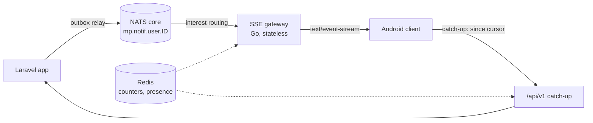

# Push notifications without Google: NATS + SSE (executable plan)

A concrete proposal for the Meningspunktet developers, from the maintainer of the
unofficial Android client. One architecture, stated plainly, with a build order.

## Requirements

| # | Requirement |
|---|---|
| R1 | A new notification reaches the user's screen within **10–15 s**, even with the app in the background |
| R2 | No third-party push servers: no FCM, APNs, Mozilla, no push distributor |
| R3 | Additive: the Inertia pages, session cookies, CSRF and website behaviour stay exactly as they are |
| R4 | Scales to **5M installs by adding nodes** — no redesign, no resharding, no flag day |
| R5 | The app keeps working by polling until the server side ships |

R1 decides the architecture: a background phone has no inbound address, so some
always-on server must hold a connection to every running device. This design
puts that connection tier outside PHP.

## Architecture



| Component | Language | Role | Grows by |
|---|---|---|---|
| API | PHP (Laravel) | catch-up endpoint, token management, existing website | adding nodes behind the LB |
| Outbox relay | Go or PHP CLI | publishes outbox rows to NATS | adding workers |
| Bus | NATS (core) | delivers `notification.created` **only** to nodes with interest | fixed 3-node cluster |
| Gateway | Go | holds SSE connections, writes frames | adding nodes behind the LB |
| Redis | Redis | unread counters, presence, auth cache, per-user hot feed | primary + replica |
| MySQL | MySQL | source of truth for content | read replicas; hot set in Redis |

## Design decisions

- **D1 — API is the source of truth; the stream is a wake-up only.** The stream
  carries event ids and unread counts, never message bodies. On any connect or
  event, the client fetches changed items by cursor. Dropped events cost a
  delayed notification, never lost data.
- **D2 — Core NATS, not JetStream.** At-most-once wake-ups suffice; no disk, no
  Raft quorum, no retention to operate.
- **D3 — One subject per user** (`mp.notif.user.<id>`), one subscription per open
  connection. NATS interest routing delivers to the right node only — no shard
  map, no broadcast-and-filter.
- **D4 — Transactional outbox.** Laravel writes an outbox row in the same
  transaction as the notification; the relay publishes. A handler publishing
  inside a transaction loses events on rollback.
- **D5 — SSE over HTTPS/2**, not WebSocket/MQTT on the client: one protocol,
  ordinary proxies, native HTTP client support.
- **D6 — Redis holds hot state** (counters, presence, auth cache, last ~50
  events per user). 304 responses and unread snapshots never touch MySQL.
- **D7 — Auth**: session cookie works from day one; per-device tokens are the
  upgrade (revocable, hashed, scoped `notifications:read`).
- **D8 — Reconnects**: jittered exponential backoff on the client; gateway sends
  `retry:` and a 30 s heartbeat. When the gateway loses NATS for >5 s it closes
  all SSE connections, so clients fall back to polling instead of sitting silent.

## Latency budget (R1)

| Hop | Budget |
|---|---|
| Laravel commits → outbox row | < 50 ms |
| Relay → NATS → gateway frame | < 100 ms |
| Frame on device → catch-up fetch | < 300 ms |
| Notification posted | < 100 ms |
| **Steady-state total** | **< 1 s** |
| Reconnect path (TCP+TLS+auth+catch-up) | < 3 s |
| Worst accepted (device just came online) | **≤ 15 s** |

## Build plan

### M1 — Catch-up API (ships first, useful alone)

- [ ] `GET /api/v1/notifications?since=<cursor>&limit=50`
- [ ] `GET /api/v1/conversations?since=<cursor>&limit=50`
- [ ] Auth: session cookie **and** `Authorization: Bearer` token
- [ ] ETag derived from the Redis unread counter → `304` with no DB query
- [ ] Explicit unread semantics: `unread.messages`, `unread.threads`,
      `unread.last_read_at`, `newest_unread` (id, body, author_id)
- [ ] No `X-Inertia` header required; no asset-hash dependency; no 409 dance

Response shape (`notifications`):

```json
{
  "data": [
    { "id": "01J...", "type": "reply", "title": "Svar fra Mette", "body": "…",
      "url": "/forum/…", "created_at": "2026-11-21T08:00:00Z", "unread": true }
  ],
  "meta": { "next_cursor": "01J..." },
  "unread": { "notifications": 3, "conversations": 1 }
}
```

Response shape (`conversations`; `url` is the tap-through target):

```json
{
  "data": [
    { "uuid": "…", "type": "group", "title": "…",
      "group": { "title": "…" }, "avatar_file_id": "…",
      "url": "/conversations/…",
      "last_message": { "id": 1234, "body": "…",
                        "author": { "id": 9, "name": "…" },
                        "created_at": "2026-11-21T07:59:00Z" },
      "unread": { "messages": 2, "threads": 1,
                  "last_read_at": "2026-11-21T07:40:00Z",
                  "newest_unread": { "id": 1234, "body": "…", "author_id": 9 } } }
  ],
  "meta": { "next_cursor": "…" }
}
```

**Done when:** with a stale cursor, activity on the site returns exactly the new
items in one request; repeating the request returns `304` without a DB query.

### M2 — Outbox → NATS

- [ ] Outbox table: `id` (ULID), `user_id`, `type`, `payload` (ids only),
      `created_at`, `published_at`
- [ ] Row written in the same transaction as notification/message creation
- [ ] Relay (single worker): reads unpublished rows in id order, publishes to
      `mp.notif.user.<user_id>`, marks `published_at`; restart-safe (at-least-once)
- [ ] NATS 3-node cluster; account permissions: Laravel publishes `mp.notif.>`,
      gateway subscribes only
- [ ] Event ids are the outbox ids (ULID), so duplicates are deduped downstream

**Done when:** killing the relay mid-batch and restarting delivers every row
(duplicates tolerated); a published event reaches a test subscriber in < 100 ms.

### M3 — SSE gateway

- [ ] `GET /api/v1/stream`, `Accept: text/event-stream`, cookie or token auth
- [ ] On connect: subscribe `mp.notif.user.<id>`, emit current `unread` snapshot
      (from Redis)
- [ ] On bus event: emit `id:` + `event: unread` + `data:` (ids/counters only)
- [ ] Heartbeat comment every 30 s; `retry: 30000`; `Last-Event-ID` is accepted
      but not replayed (D1: the client's cursor is the resume mechanism)
- [ ] NATS unreachable > 5 s → close all connections (D8)
- [ ] Graceful drain on SIGTERM: stop accepting, hold ≤ 10 s, close
- [ ] Stateless; N nodes behind an L4 pass-through load balancer (long idle
      timeout; TLS terminated on the gateway)

```
retry: 30000

event: unread
data: {"notifications":3,"conversations":1}

id: 01J...
event: notification
data: {"ids":["01J..."]}

: heartbeat
```

**Done when:** end-to-end (Laravel write → frame on a test client) < 1 s;
stopping NATS closes connections and clients degrade; drain loses no events
(clients catch up on reconnect).

### M4 — Per-device tokens

- [ ] `POST /api/v1/tokens` (session-authenticated, from a settings page) →
      `{ "token": "mp_…", "scopes": ["notifications:read"], "id": "…" }`
- [ ] Stored hashed; listed and revocable per device
- [ ] Revoked token → `401` on stream and API

**Done when:** revoking a device stops its stream and API access without
touching the user's password.

### M5 — Client switch (this repository)

- [ ] SSE client inside the foreground service: connect, jittered reconnect,
      cursor storage, dedupe by event id
- [ ] On event or connect: catch-up fetch, then post notifications (existing
      own-message suppression applies)
- [ ] Stream unavailable → keep the adaptive poll (60 s foreground / 5 min
      background) as degraded mode
- [ ] Token support with cookie fallback

**Done when:** background delivery on a device is ≤ 15 s end to end; stopping the
gateway still delivers (slower) via polling.

### M6 — Operations

- [ ] Load balancer: L4 pass-through, idle timeout ≥ 10 min, connection draining
- [ ] Kernel tuning on gateway nodes: `nofile` ≥ 1M, `somaxconn`, SYN backlog,
      port range, conntrack
- [ ] Monitoring: connections per node, handshake rate, NATS subscription count,
      Redis ops, catch-up p95, fallback fraction
- [ ] Load test at 2× expected concurrency (k6/vegeta) and measure handshake cost
- [ ] Capacity runbook: add a gateway node when connections > 150k or RAM > 70 %

**Done when:** a soak test at target concurrency holds p95 catch-up < 1 s and no
node exceeds limits.

## Capacity and hardware

Assumptions: TLS 1.3 on the gateway, ~25 KB per socket, 30 s heartbeat,
15–30 min socket lifetime, 1–2 ms per handshake. Churn — not message rate —
dominates gateway CPU.

| Installs | Sockets | Gateway | NATS | Redis | API (Laravel) | MySQL | Relay |
|---|---|---|---|---|---|---|---|
| 100k | 100k | 2–3 × (2 vCPU, 4 GB) | 3 × (1 vCPU, 2 GB) | 2 × (1 vCPU, 2 GB) | 2 × (4 vCPU, 8 GB) | existing + 1 replica | 1 × (1 vCPU, 1 GB) |
| 1M | 1M | 8–12 × (4 vCPU, 8 GB) | 3 × (2 vCPU, 4 GB) | 2 × (2 vCPU, 4 GB) | 6–10 × (4 vCPU, 8 GB) | primary + 2–3 replicas | 1 × (2 vCPU, 2 GB) |
| 5M | 5M | 25–40 × (8 vCPU, 16 GB) | 3 × (4 vCPU, 8 GB) | 2 × (4 vCPU, 8 GB) | 15–25 × (8 vCPU, 16 GB) | replicas + hot set in Redis | 2 × (2 vCPU, 4 GB) |

TLS churn: 55–110 / 550–1,100 / 3,000–6,000 handshakes/s at 100k / 1M / 5M.
Thundering herd (5M reconnects in 30 s ≈ 167k handshakes/s ≈ 250 cores) is
handled by client jitter and staged drain, not by hardware.

**Notification traffic PHP still sees** (stream removes the wake-up, not the
reads; assumes ~10 % of devices in fallback polling at any time):

| Source | 100k | 1M | 5M |
|---|---|---|---|
| Reconnects → catch-up | 55–110 req/s | 550–1,100 req/s | 3,000–6,000 req/s |
| Fallback polling (5 min) | ~33 req/s | ~333 req/s | ~1,700 req/s |
| **Total API load** | **< 200 req/s** | **< 1,500 req/s** | **< 8,000 req/s** |

For context, a fixed 60 s poll would be 1,700 / 16,700 / 83,000 req/s. 304-only
responses cost no database query.

Cost order of magnitude: 2–3 small VMs at 100k; €2k–5k/month at 5M on commodity
VPS. Heartbeats at 5M are ~7 MB/s; handshake peaks add a few hundred Mbit/s.

## Degraded modes

| Failure | Behaviour | R1 impact |
|---|---|---|
| Gateway node down | clients reconnect to another node | none (seconds) |
| NATS unreachable | gateway closes connections; clients poll | R1 violated until fixed |
| Doze / OEM battery saver | socket dropped; client reconnects; some OEMs delay more | minutes on aggressive OEMs; recommend battery-optimization exemption |
| Gateway fleet overloaded | new connections queue; existing hold | drain/jitter; add nodes (R4) |
| MySQL slow | 304s unaffected (Redis); catch-up slower | still < 15 s unless DB is broken |

## Non-goals

- No change to the website UI, views, cookies or CSRF handling (R3).
- No JetStream, no Kafka, no MQTT on the client, no Web Push.
- No message bodies on the bus or in SSE frames (privacy; D1).

## Why not the alternatives (for the record)

| Option | Why not |
|---|---|
| Fixed polling | violates R1 at scale (83k req/s at 5M for one feed) |
| Long-polling | one request per hold regardless; 200k req/s at 5M with a 25 s hold |
| Kafka | does not hold connections; a cluster to operate; only worth it as a general event platform |
| MQTT broker | meets R1, but a second protocol and a persistent-session backlog that competes with the API as source of truth |
| UnifiedPush / ntfy | meets R1 with zero infrastructure, but delivery requires a second (distributor) app on the device - ruled out. Embedding a distributor collapses back into holding sockets yourself |
| Web Push | relays through the browser vendor's push service (FCM/Mozilla); fails R2 |

## Sequencing

M1 → M2 → M3 can ship independently and each is useful alone; M4 and M6 in
parallel with M5. Nothing needs a flag day: clients poll until the stream
answers, then switch.
